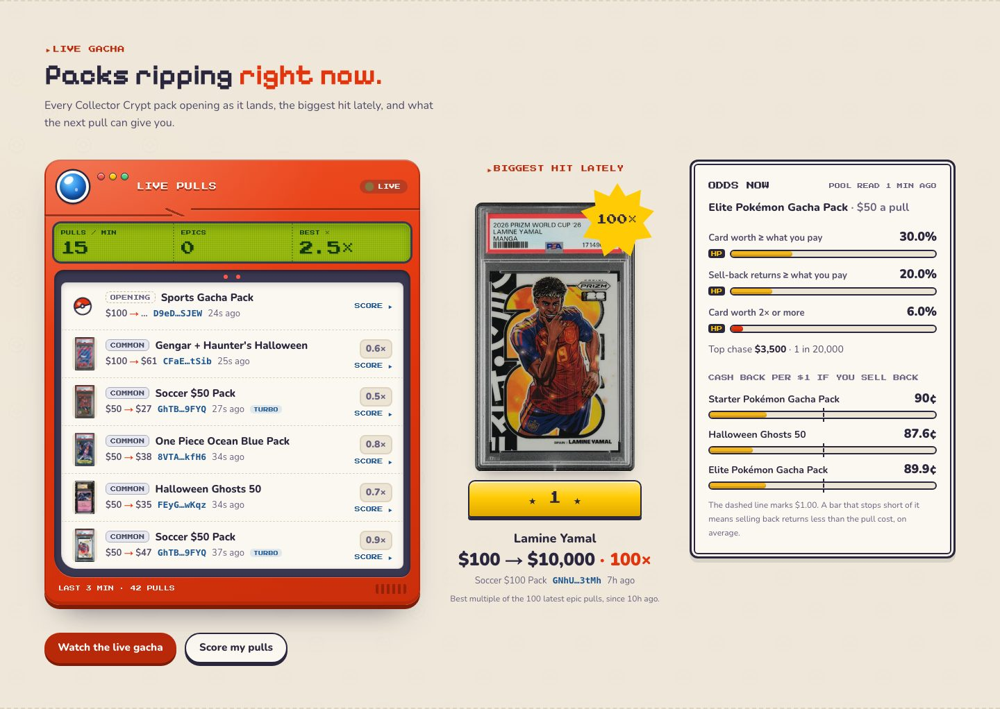
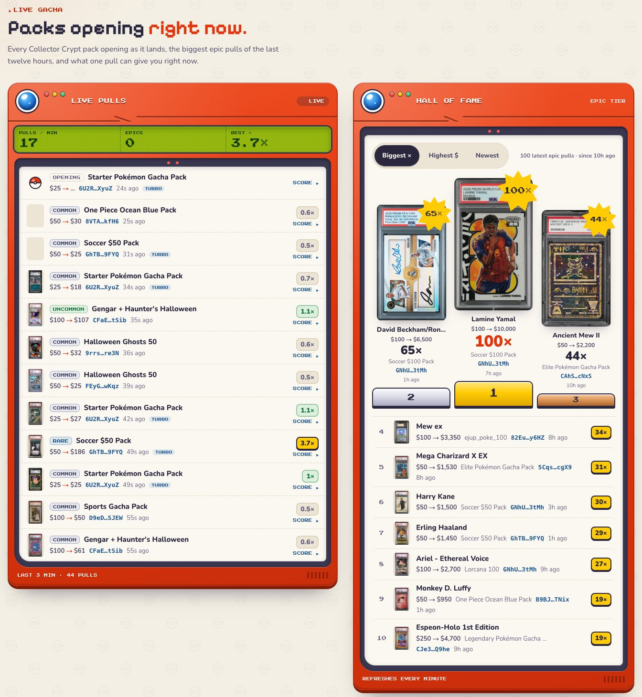
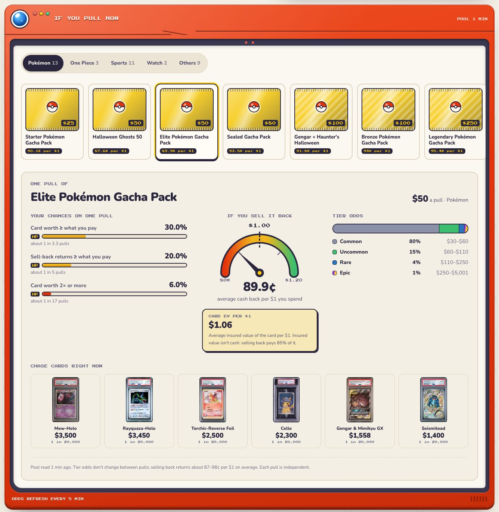
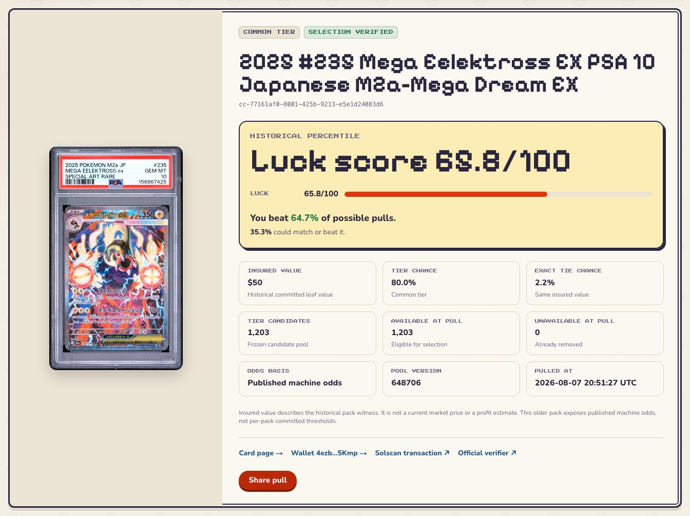
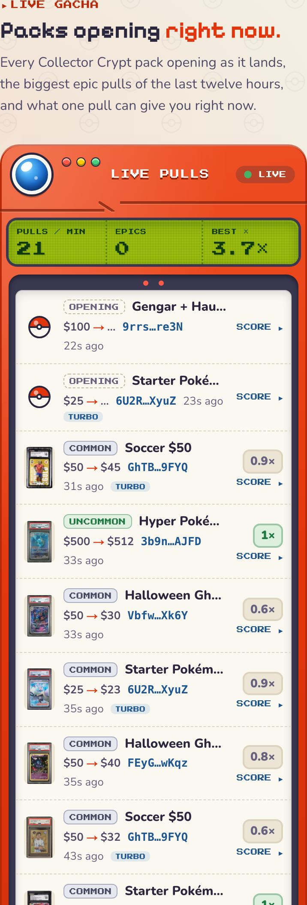

<div align="center">

<a href="https://www.decard.fun"></a>

# Decard

**The free, open-source scanner and tracker for [Collector Crypt](https://collectorcrypt.com) graded cards on Solana.**<br>
DexScreener, Magic Eden, GMGN and Arkham for card traders, wrapped in a Game Boy.

[](https://www.decard.fun)
[](./LICENSE)
[](https://nextjs.org)
[](./tsconfig.json)
[](#configuration)
[](#live-gacha)

**[Open decard.fun](https://www.decard.fun)** · [Live gacha](https://www.decard.fun/luck#live) · [Listing scanner](https://www.decard.fun/scanner) · [Trade tape](https://www.decard.fun/tape) · [Trainer's guide](https://www.decard.fun/guide)

✨ **New:** [live gacha + pull luck](#live-gacha). Watch every rip, know your odds, prove your luck.

</div>

---

Collector Crypt vaults real PSA, CGC and BGS slabs and trades them as tokens on Solana. Its marketplace shows what's for sale. **Decard shows what's worth buying**: every live listing on Collector Crypt and Magic Eden ranked by discount to insured value, every on-chain sale and bid as it lands, and any wallet's collection. Now it watches the gacha too: every pack as it rips, the odds of your next pull, and a verified luck score for every pull. Read-only and keyless: no login, no wallet connection, no API key.

<a href="https://www.decard.fun"></a>

<a id="live-gacha"></a>

## ✨ New: Live Gacha + Pull Luck

**Watch every rip. Know your odds. Prove your luck.**

Collector Crypt collectors rip 20 to 30 gacha packs a minute. Decard now puts every one on screen the moment it opens, crowns the biggest epic hits, shows what one pull can do *before* you buy, and scores every pull you've made against the exact card pool it was drawn from. No "trust me bro" odds: the luck math replays Collector Crypt's own VRF proof.

<a href="https://www.decard.fun/luck#live"></a>

<table>
  <tr>
    <td width="50%" valign="top">
      <a href="https://www.decard.fun/luck#live"></a>
      <br><b>🔴 Live pulls + 🏆 Hall of Fame</b><br>Every pack as it lands: the card, its value, the multiple and the wallet. Epic hits flash the Pokédex lens. The Hall of Fame ranks the latest 100 epic pulls by multiple. When this was captured, #1 was a $100 soccer pack that pulled a $10,000 Lamine Yamal (100×).
    </td>
    <td width="50%" valign="top">
      <a href="https://www.decard.fun/luck#odds"></a>
      <br><b>🎯 If you pull now</b><br>Pick a pack before you rip it: your chance the card beats the price, that the instant buyback pays you back, and that you double up. Plus the chase cards with their exact 1-in-N odds and a gauge of the cents you get back per $1. Read from the live pool every 5 minutes.
    </td>
  </tr>
  <tr>
    <td width="50%" valign="top">
      <a href="https://www.decard.fun/luck?memo=cc-77161af0-8001-425b-9213-e5e1d24083d6"></a>
      <br><b>🍀 Pull luck</b><br>Paste a wallet and every pull it opened gets a luck score out of 100, replayed against the frozen pool and odds behind its VRF proof. 50 is average luck. The whole wallet gets a score too, compared with fair runs of the same length. If Collector Crypt's verifier wouldn't pass a pull, Decard won't score it.
    </td>
    <td width="50%" valign="top" align="center">
      <a href="https://www.decard.fun/luck#live"></a>
      <br><b>📱 Made for thumbs</b><br>The same Pokédex on a phone, an iPad or a desktop. Check it between rips.
    </td>
  </tr>
</table>

## Highlights

<table>
  <tr>
    <td width="50%" valign="top">
      <a href="https://www.decard.fun/scanner"></a>
      <br><b>📡 Listing scanner</b><br>Every live listing on Collector Crypt (USDC) and Magic Eden (SOL). Sort by best deal, newest or price, and filter by category, venue and price.
    </td>
    <td width="50%" valign="top">
      
      <br><b>🃏 Card pages</b><br>Flip the slab, compare the price with insured value, and read the PSA or CGC pop report, live bids, owner and on-chain history.
    </td>
  </tr>
  <tr>
    <td width="50%" valign="top">
      <a href="https://www.decard.fun/tape"></a>
      <br><b>⚡ Live trade tape</b><br>Sales, listings, reprices and bids decoded from the Collector Crypt marketplace program, with a bulk-bot filter and a playable Game Boy.
    </td>
    <td width="50%" valign="top">
      
      <br><b>🔎 Wallet tracer</b><br>Paste any Solana address for its graded cards, insured value and marketplace activity. Label whales and star wallets to a watchlist.
    </td>
  </tr>
</table>

## Features

- **Deal score.** `(1 − price ÷ insured value) × 100`, clamped to 0–100, on every USDC listing with an insured value. Higher means further under insured value. It's a filter, not a guarantee.
- **Scanner.** Category chips with live counts, venue and price filters, list or grid view, and Load more on every sort. The server-rendered [graded card directory](https://www.decard.fun/cards) exposes exact names, grades, sets and years to search engines and AI crawlers.
- **Trade tape.** Hides bulk bid bots by default, shows who bid on whom, and refreshes every 10 seconds.
- **Card pages.** Rarity tier from the pop report, gem rate, PSA and CGC cert lookups, and each live bid as a share of insured value.
- **Wallets.** Holdings sorted by insured value, list price or name, plus decoded activity. Labels and the watchlist stay in your browser (localStorage).
- **Live gacha.** Live pulls refresh every 10 seconds, the Hall of Fame every minute and pack odds every 5 minutes. New epic hits are announced to screen readers, and the animations respect reduced-motion settings.
- **Pull luck.** `luck = P(a worse pull) + ½ × P(an equal-value pull)`, with the tier odds applied first and every available card in the rolled tier equally likely, the way Collector Crypt's VRF picks them. A wallet's score is the average over its latest 50 pulls, compared with fair runs of the same length.
- **Trainer's guide.** A plain-language glossary of grading, pop reports, gem rate, insured value, bids and vaults, plus a sourced [guide to tokenized trading cards on Solana](https://www.decard.fun/tokenized-trading-cards).
- **Easter eggs.** Tap the 3D Poké Ball to catch a deal, and try ↑ ↑ ↓ ↓ ← → ← → B A.

## How it works

There is no database and no indexer. Next.js route handlers read public sources, cache them briefly and serve the browser through `/api`:

| Source | Used for | Key |
|---|---|---|
| Collector Crypt marketplace API | listings, card details, insured values, bids, pop reports, holdings | none (optional `CC_API_KEY` raises rate limits) |
| Collector Crypt image CDN | card images, pre-sized WebP | none |
| Solana RPC: public endpoint, or Helius | trade tape, card and wallet history | none (optional `HELIUS_API_KEY`) |
| Collector Crypt gacha site | live pulls, recent epic hits, machine odds, pool snapshots, VRF proofs | none |
| Solana RPC: full-history public endpoint, or Helius | a wallet's gacha pack history | none |
| Jupiter, then CoinGecko | live SOL price | none |

The server-side fetcher times out slow calls, retries throttled or failed reads with backoff, holds each upstream host to a rate limit and merges identical requests, so a burst of visitors costs one upstream call.

## Quick start

Requires Node.js 20.9 or newer.

```bash
git clone https://github.com/AlleyBo55/decard
cd decard
npm install
npm run dev
```

Open [http://localhost:3000](http://localhost:3000). It works with zero configuration.

## Configuration

Copy `.env.example` to `.env`. Every variable is optional.

| Variable | Scope | What it does |
|---|---|---|
| `HELIUS_API_KEY` | server only | Makes Helius the primary Solana RPC, with the public RPC as fallback when Helius is throttled or down. Free key at [helius.dev](https://dashboard.helius.dev). |
| `CC_API_KEY` | server only | Raises Collector Crypt rate limits 10x. Ask support@collectorcrypt.com. |
| `NEXT_PUBLIC_SITE_URL` | public | Canonical origin for SEO tags, `robots.txt`, `sitemap.xml` and `llms.txt`, e.g. `https://www.decard.fun`. On Vercel it falls back to the production domain. |
| `NEXT_PUBLIC_GA_ID` | public | Google Analytics 4 measurement ID (`G-…`). Unset loads no analytics. |

Never put a key in a `NEXT_PUBLIC_` variable: those values are baked into the JavaScript every visitor downloads.

## Deploy

[](https://vercel.com/new/clone?repository-url=https%3A%2F%2Fgithub.com%2FAlleyBo55%2Fdecard)

1. Import the repo on Vercel, or click the button. No build settings to change.
2. Under **Settings → Environment Variables**, set `NEXT_PUBLIC_SITE_URL` to your domain, plus any optional keys.
3. Deploy. `NEXT_PUBLIC_` values are read at build time, so redeploy after changing them.

Search files come built in: `sitemap.xml` lists up to 20,000 listed graded cards and refreshes its data every 6 hours, and `llms.txt` gives AI assistants a plain-text summary of the site.

## Tech

**Next.js 16** (App Router, Turbopack) · **React 19** · **TypeScript** (strict) · **Tailwind CSS v4** · **Redux Toolkit Query** for fetching and live polling · **Motion** for animation · **Three.js** with React Three Fiber for the 3D Poké Ball

```
src/
├── app/          routes, /api handlers, sitemap, robots, llms.txt, share image
├── components/   scanner, tape, card, wallet, gacha, luck, Game Boy and guide UI
├── services/     one function per /api call the browser makes
├── store/        RTK Query endpoints, wallet labels and watchlist
├── hooks/        data hooks for each page
├── helpers/      shared fetcher: timeouts, retries, rate limits
└── lib/          Collector Crypt, gacha and Solana clients, VRF luck math, decoding, formatting, SEO
```

## Honest limits

- Decard reads a **recent window** of on-chain activity, not all-time history. An all-time "top buyer" leaderboard needs an indexer, which this project deliberately doesn't run.
- Amounts and wallets come from the Collector Crypt program's own instruction data: list and reprice prices, bid amounts with the bidder and the owner being bid on, and gross prices on sales and taken bids.
- A pulled bid carries no amount, and a reprice shows its old price only when the earlier listing is in the same window. When a bid doesn't name the owner, Decard shows the card's current holder instead, marked as such.
- Instruction layouts we haven't verified stay blank. We'd rather show you nothing than a made-up number.
- The live gacha reads feeds that Collector Crypt's own gacha site uses. They aren't a documented API and can change, so a broken feed hides its panel instead of showing a guess.
- "If you pull now" combines the published tier odds with the newest pool snapshot for the tier that decides each number, refreshed every 5 minutes. Pools move between pulls: these are the odds of the next pull, not a promise.
- Luck scores rank pulls by insured value, not market price or profit. Every pull is independent, so a bad streak doesn't make the next pack luckier. On average, packs return less than they cost if you sell them back (87–98¢ per $1 when this was written).

## FAQ

<details>
<summary><b>Is Decard affiliated with Collector Crypt?</b></summary>

No. Decard is independent and fan-made. It reads Collector Crypt's public API and the Solana blockchain, and links to Collector Crypt and Magic Eden when you want to buy.
</details>

<details>
<summary><b>Do I need to connect a wallet?</b></summary>

No. Decard is read-only: no account, no wallet connection, no API key. Paste any Solana address to see that wallet's cards and activity.
</details>

<details>
<summary><b>Which cards does it cover?</b></summary>

Every graded card listed on Collector Crypt: Pokémon, One Piece, Riftbound, Dragon Ball, Lorcana, Magic: The Gathering, Yu-Gi-Oh!, Gundam and sports cards, graded by PSA, CGC, Beckett (BGS) and others.
</details>

<details>
<summary><b>Can Decard improve my gacha odds?</b></summary>

No. Each machine's tier odds are fixed, and every pull is decided by a VRF roll on your own wallet signature, so nobody can time or steer it, Decard included. Decard shows you the real odds before you rip and checks the math after.
</details>

<details>
<summary><b>Can I run my own copy?</b></summary>

Yes. It's MIT-licensed and needs no keys: clone it and run `npm run dev`, or use the Vercel button above.
</details>

## Contributing

PRs welcome: new data sources, more wallet labels (`src/lib/wallet-labels.json`), extra categories, a prettier slab viewer. Run `npm run lint` and `npm run build` before you open one.

## A note on the theme

Decard is a fan-made homage to the handheld that raised a generation. It ships **zero** copyrighted sprites or trademarks: the Poké Ball is original geometry, the fonts are open source (SIL OFL) and the palette is ours. Pokémon™ is a trademark of Nintendo, Creatures and GAME FREAK. Decard is not affiliated with or endorsed by them, or by Collector Crypt. Nothing here is financial advice.

## License

[MIT](./LICENSE). Use it, fork it, sell it, learn from it. Just keep the notice.

<div align="center">

**Built for the traders, rippers and collectors of the Solana card era.**<br>
If it saved you a bad buy, or proved that rip was a Legendary, drop a ⭐.

</div>
